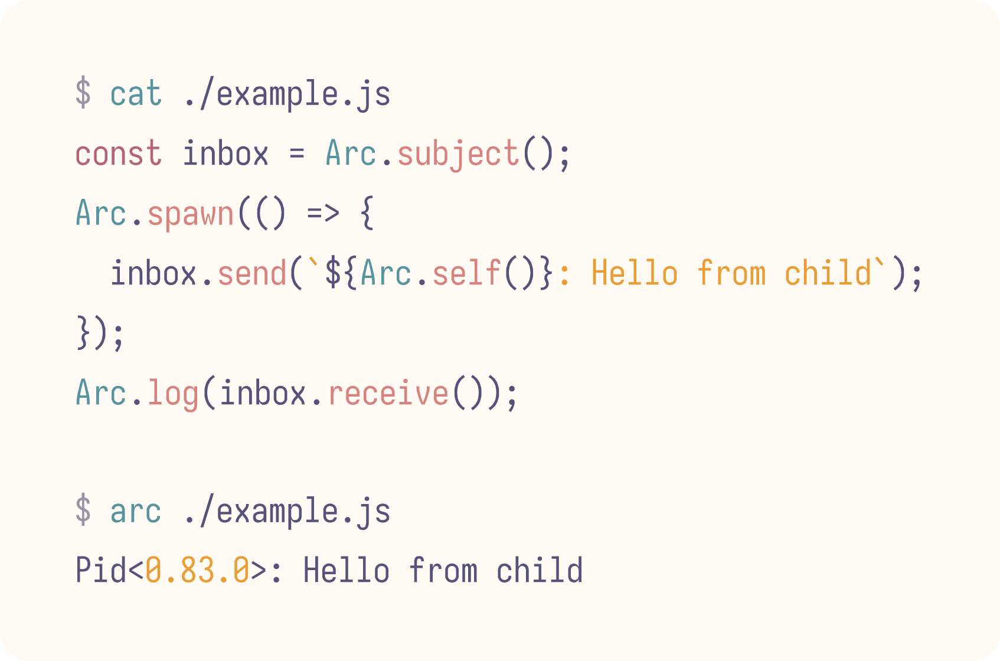
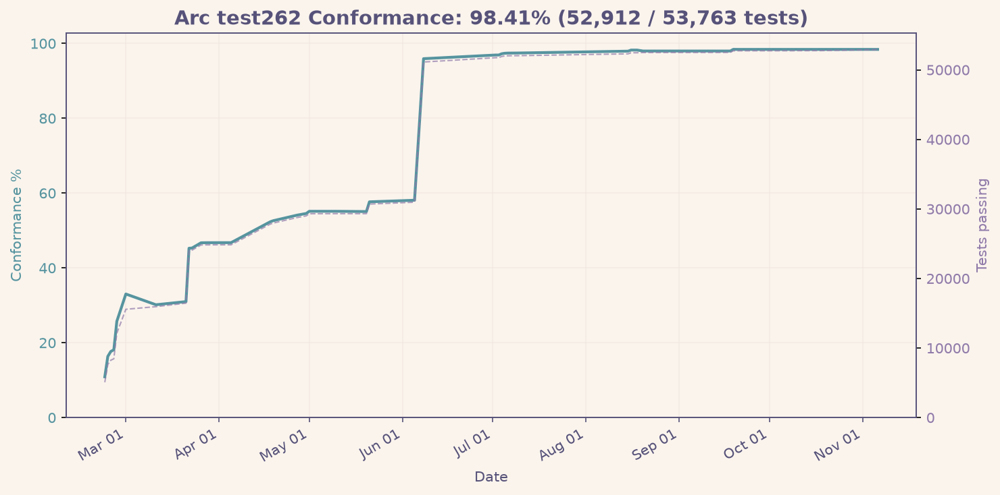

# arc ⌒

JavaScript on the BEAM

<picture>
  <source media="(prefers-color-scheme: dark)" srcset="./.github/js.png">
  
</picture>
  

Arc is a JavaScript engine and runtime written in [Gleam](https://gleam.run). It implements the ECMAScript spec. On its own it has no effects, timers or I/O. The program that embeds Arc provides those, and Arc's embedding API makes that easy.

There's also [Spark](./spark), a Node.js compatibility layer for Arc. Spark _does_ provide I/O and timers, such as `fs.readFile` and `setTimeout`. You can think of Arc as the equivalent of JSC or V8, and Spark as the equivalent of Bun or Node.js.

Arc's API can change from one commit to the next, which is true of many engines. We recommend pinning to a commit SHA and upgrading on a regular schedule.
  

By default Arc interprets JavaScript, but it can also compile JavaScript to Erlang ahead of time (AOT). AOT has tradeoffs, and we don't recommend it for dynamic code, such as code generated at runtime. Arc runs on Erlang/OTP, and in the browser on our own fork of [AtomVM](https://www.atomvm.net) compiled to WebAssembly. We forked AtomVM to make it faster in the browser.
  

Arc is tested against [test262](https://github.com/tc39/test262) on every commit:

<picture>
  <source media="(prefers-color-scheme: dark)" srcset=".github/test262/conformance-dark.png">
  
</picture>

  

Arc uses the Mozilla Public License, Version 2.0.
